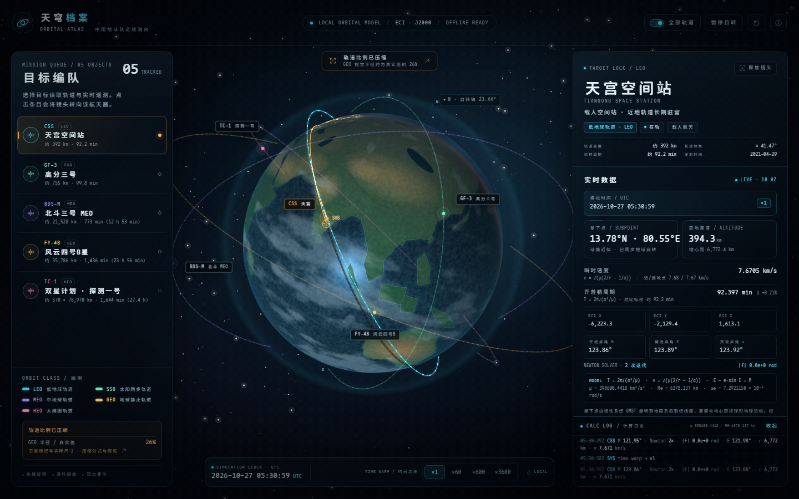

# 天穹档案 · 中国地球轨道观测台

单文件、纯前端、离线可运行的中文天文科普站。围绕可自由旋转的 WebGL 地球，展示 5 颗中国航天器的轨道、实时遥测与地面轨迹。

**在线预览：** https://fizmie.github.io/earth-orbital-atlas/

**直接运行：** 下载 [`index.html`](index.html) 后双击打开，无需安装、无需联网。

## 交互

- 鼠标拖动旋转，滚轮缩放；触屏单指旋转、双指缩放。
- 左侧「目标编队」选择目标，右侧查看实时数据；点击「聚焦镜头」飞到目标。
- 顶部：全部轨道开关、暂停空闲自转、重置视角、说明弹窗。
- 底部：×1 / ×60 / ×600 / ×3600 时间倍率。
- 窄屏自动切换为底部抽屉。

## 页面内置

- 程序化生成的云层、海陆、夜间灯光与大气辉光，无任何外部图片或字体请求。
- 二体开普勒轨道、牛顿迭代求偏近点角、ECI/ECEF 与星下点换算、活力公式速度。
- 开普勒周期与标称值对照、模拟 UTC、滚动计算日志与公式常数。
- 轨道每帧更新；遥测与计算日志约每 100ms 更新。

## 科学说明

这是一个教学模拟，不是真实星历。页面使用固定演示历元、二体近似与球形地球，忽略 J2、大气阻力、太阳光压、第三体摄动和轨道保持。轨道半径经过视觉压缩，卫星标记不代表真实尺寸；为保证轨道环与地球视觉同心，屏幕上的轨道环与卫星标记还做了居中平移，数值和地面轨迹仍按真实焦点椭圆计算。探测一号为已再入的历史任务。

完整假设、压缩映射与常数见页面内的「比例与假设」窗口。

字体使用本机 Maple Mono CN，并配置系统无衬线 / 等宽回退链。
